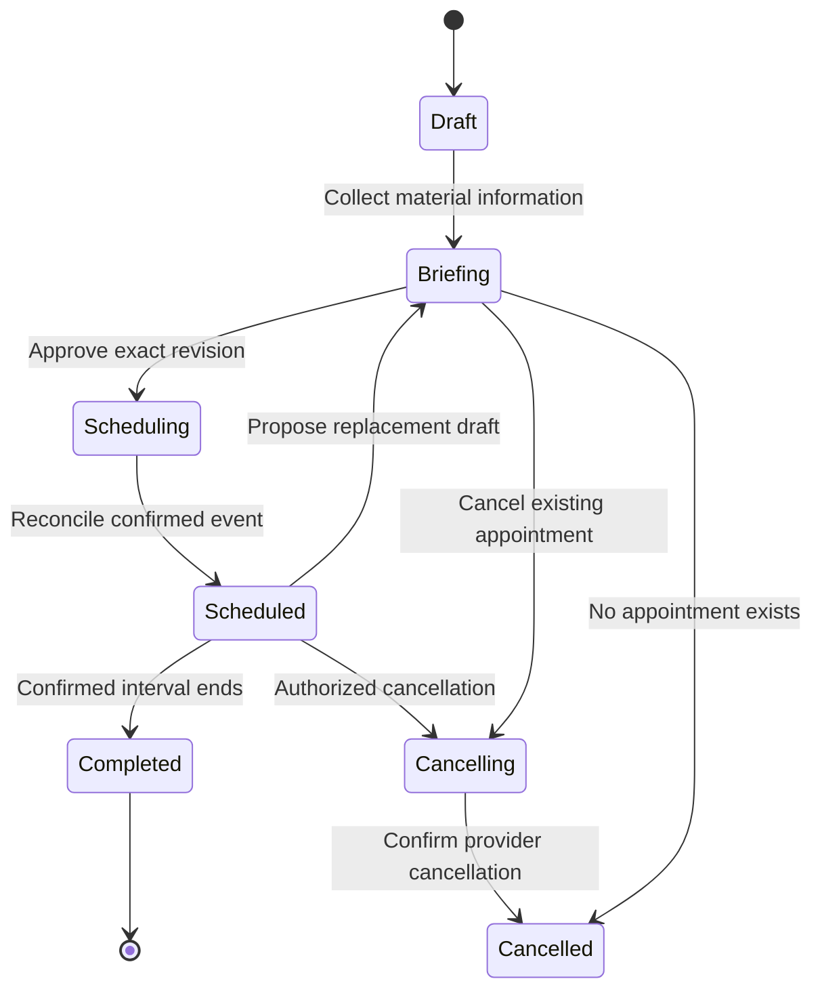

# Conversation Helper — implementation specifications

Version: 2026-09-21. Language: English for every interface, notification and developer-facing contract.
This is a contract-first implementation handoff. Normative requirements use **MUST**, **SHOULD** and **MAY**.
The accompanying TypeScript and Python declarations describe boundaries, not working implementations.

## 1. Product decision and delivery status

The team uses **paid Slack**. **Slack Huddles is the only call provider. Google Meet MUST NOT be created, offered or silently selected.**
Google Calendar remains the invitation, time and attendee-calendar system; its event contains a verified Huddle join link.
Use existing account entitlements and free/open-source components; do not introduce a new paid service by default.

| Status | Scope | What the status does not establish |
|---|---|---|
| CURRENT | Tasks-app MCP connector at `/api/mcp`, deployed source `5171b08` (subsequent documentation `d58f445`), and public Ultrabricks source organization | Every participant has authorized the connector; meeting automation is live |
| EXISTING PROTOTYPE | Conversation Helper Slack/Calendar adapters, briefing, jobs, transcript import, task publication and operator console with local tests | Final review, Huddles-only compliance, production rollout or a live team acceptance run |
| PROPOSED | This complete specification, typed interfaces, centralized onboarding, corrected publication semantics and full Huddle workflow | These declarations are deployed code |

The existing prototype is preserved separately and is not the published default implementation. It still contains Meet-oriented settings/instructions and pending review findings.
The public `conversation-helper` repository's default branch contains this specification and contracts; publication of those files does not publish the prototype as a finished product.
Source locations: `https://git.hyperide.ai/ultrabricks/tasks-app` and `https://git.hyperide.ai/ultrabricks`.
Tasks production UI: `https://tasks-ultrabricks.vercel.app/issues`; MCP endpoint: `https://tasks-ultrabricks.vercel.app/api/mcp`.
Parent workstream evidence: 190 unit tests, five PostgreSQL security tests and 11 live unauthenticated/OAuth-boundary checks; user OAuth was not performed.
Public source MUST NOT expose workspace records, credentials, recordings, transcripts or test-account sessions.

## 2. System boundaries and ownership

| Component | Responsibility | Must not do |
|---|---|---|
| SlackIngress | Receive authenticated commands, mentions, thread replies and interactions | Execute model-supplied tools or accept another workspace |
| IdentityDirectory | Resolve exact Slack IDs, verified profile emails and actual Tasks membership | Guess identity from a first name or voice |
| MeetingCoordinator | Own meeting revisions and authorized transitions | Let a proposal silently mutate a scheduled event |
| BriefingService | Assemble outcome, agenda, moderator and role-specific preparation | Send generic questions unrelated to a person's topics |
| CalendarGateway | Availability, invitations, event updates and reconciliation | Create a conference other than the supplied Huddle reference |
| ParticipationService | Local signals, native Calendar responses and time proposals | Represent a local Slack signal as an authenticated Calendar RSVP |
| HuddleGateway | Resolve and verify supplied/documented Huddle links and capabilities | Promise an unsupported Huddle creation/recording API |
| DurableJobStore / ReminderService | Durable delivery, retry, recipient receipts and current reminders | Treat an API attempt as confirmed delivery |
| RecorderAdapter / TranscriberAdapter / TranscriptStore | Consent-aware capture integrations, transcription and source versions | Infer that audio was captured because a meeting existed |
| EvidenceAnalyzer | Propose evidence-backed decisions, open questions and commitments | Authorize writes or invent an owner/deadline |
| TaskPublisher / FollowupPublisher | Publish reviewed snapshots and track actual results | Read mutable analysis during a queued publication |
| AdminOnboarding / ModelGateway / AuditSink | Capabilities, authorized accounts, model routes and audit | Reuse unrelated credentials or claim missing capabilities |

## 3. Shared records and invariants

- IDs MUST be stable opaque strings scoped to the tenant/workspace; timestamps MUST be UTC instants with the original IANA time zone retained.
- `MeetingRevision` MUST include organizer, moderator, participant identities, agenda, desired outcome, duration, local time, resolved UTC interval and Huddle reference.
- An agenda item MUST have a stable ID, topic and intended result; it MAY include presenter, responsible owner, materials, preparation deadline and time allocation.
- A participant MAY have multiple roles across agenda items. Role assignment MUST NOT be inferred from seniority or job title alone.
- A current confirmed appointment and an unconfirmed draft revision MUST remain distinct records.
- `ReviewSnapshot.meetingRevision` MUST equal `ReviewSnapshot.meeting.revision`; `CalendarInvitation.approval.meetingRevision` MUST equal `CalendarInvitation.meeting.revision`. Reject mismatches before persistence or any external effect; P1 fixtures MUST include both mismatch cases.
- Interactive controls MUST carry meeting ID, applicable revision and operation ID; consent controls additionally carry consent-notice ID.
- All writes MUST enforce tenant, actor permission and expected version in the domain layer, regardless of transport.
- External effect identifiers, reviewed publication snapshots and delivery receipts MUST survive process restarts.
- Missing access, evidence, identity or availability MUST be represented explicitly as unknown, never as success or absence.

## 4. Slack input, thread state and identity

Requirements: support `/meeting <free text>` and an explicit `@mention` in an allowlisted channel; use one root thread as the visible meeting record.
The dedicated Slack app MAY use Socket Mode. A native ChatGPT trigger is a distinct transport with its own supported event types.
The UI MUST identify which route is active; slash-command support in the standalone app does not imply native-trigger support.
Persist the inbound envelope before acknowledgement of accepted work; repeated delivery MUST reuse the same request ID.
Deduplicate one physical Slack message by workspace/channel/message timestamp across overlapping `message` and `app_mention` events.
Ignore bot-authored loops and unrelated messages. Edits require an explicit supported edit transition; they MUST NOT silently replay a create.
Resolve invitees from exact Slack member IDs against current workspace profiles before final invitation; a changed email forces renewed review.
Keep Slack user ID, Calendar identity and Tasks member ID separate; email is a mapping claim with provenance, not a universal primary key.
Preparation messages MUST link back to the exact meeting thread and explain where replies are collected.
Acceptance: duplicate envelopes, transient model failure, overlapping event types and a renamed/deactivated member produce no lost request or unintended invitation.

## 5. Briefing, moderator and role preparation

Before invitations, the organizer sees a concrete briefing: objective, desired decisions, agenda, exact time/time zone, duration, attendees, moderator and Huddle destination.
Ask only material missing questions. The default organizer MAY be proposed as moderator, but the final moderator MUST be explicit and an attendee.
Ask presenters for subject, time allocation, material link and preparation deadline; ask owners for status/blockers; ask decision makers for decision/evidence needed.
Store replies with their author, agenda-item association and timestamp; clarify contradictions instead of overwriting another person's statement.
Pending preparation is visible, with an explicit distinction between required preconditions and optional contributions.
Scheduling MUST require organizer/moderator approval of a specific revision; approval does not authorize later unreviewed additions.
Acceptance: a participant with two roles receives the questions and reminders relevant to both agenda items without duplicate generic messages.

## 6. Calendar invitations, RSVP and negotiation

Check accessible calendars for the proposed UTC interval. `busy`, `free` and `unknown` are distinct results with reasons.
Reject known conflicts; require explicit acknowledgement of unknown availability. Resolve nonexistent or repeated daylight-saving wall times explicitly.
Create one event using a deterministic provider-supported ID where possible; invitations go to the reviewed email set with provider notification enabled.
The event description MUST include agenda, moderator, meeting reference and the validated Huddle join link; no Meet conference data may be requested.
On ambiguous create success, reconcile by deterministic event ID/reference before retrying. Record the actual event URL and provider version/ETag.
Local Slack acceptance, tentative response and decline MUST be labelled as coordination signals unless participant-specific Calendar authorization actually applies.
The official Google Calendar Slack app MAY handle actual RSVP after personal or domain-wide authorization; keep its notifications distinct from helper messages.
Participants can propose another time with a reason; only organizer/moderator can approve the replacement after reviewing conflicts and the latest draft.
Update the existing event, preserve legitimate native response fields, notify invitees and reconcile concurrent external edits through provider version checks.
Acceptance: a stale button or a proposal alone cannot change the appointment; cancellation during asynchronous availability checking cannot be overwritten.

## 7. Huddle reference and lifecycle

`HuddleGateway` accepts a genuine link obtained through a documented Slack flow and associates it with an allowed workspace/channel or conversation.
Where an API cannot verify link identity or access, return `unverified` with the reason and require an explicit admin/organizer check.
A Huddle link may start/join a call when opened; storing it in Calendar does not prove an active call has been created.
Slack Calls API represents external calls; it MUST NOT be treated as an undocumented Huddle creation API.
Paid Slack permits the team's group-Huddle scenario; actual plan capabilities and participant access remain runtime checks.
Do not infer call start, attendance, end, recording or transcript availability from a scheduled Calendar interval.
Represent lifecycle observations with provenance: `scheduled_reference`, `observed_active`, `observed_ended` or `unknown`.
Acceptance: every invitation/reminder exposes the same verified destination, and provider-unavailable errors never fall back to Meet.

## 8. Scheduling state machine and concurrency

A durable completion check drives `Scheduled` to `Completed` after the confirmed UTC interval ends, rechecking the confirmed revision before changing state. Completion does not imply a transcript exists or publication has finished.
The active confirmed snapshot remains valid during replacement briefing. Scheduling failures retain a retryable operation, not a fake `scheduled` state.
After every awaited external read, recheck relevant versions before saving; update only intended fields and preserve concurrent preparation replies.
Calendar cancellation and revision MUST cancel obsolete scheduling/reminder jobs, but MUST NOT erase independently approved post-meeting publication work.
Acceptance: concurrent reply, revise, confirm, cancel and provider callbacks cannot resurrect obsolete state or lose unrelated participant input.

## 9. Durable jobs and reminders

Persist inbox, outbox, attempts, leases, retry schedule, idempotency key and delivery receipts transactionally with state transitions.
Use stable job identity per meeting/revision/recipient/purpose; one recipient's failed delivery MUST NOT replay another recipient's completed delivery.
Retry transient failures with bounded backoff; surface permanent failures and exhausted attempts for explicit operator retry.
Worker lease recovery MUST handle process death; expired leases do not authorize two simultaneously active workers to publish blindly.
Before sending a reminder, validate confirmed revision, cancellation state, due time, recipient decline and existing equivalent native reminders.
Preparation reminders include the person's topics/material/deadline; join reminders include Huddle link and moderator. Respect configured quiet hours and time zones.
Skip stale reminders after downtime; report missed reminders separately from successful delivery. Do not send a morning-preparation reminder after the meeting ended.
The service MAY promise at-least-once delivery with reconciliation; it MUST NOT claim exactly-once Slack delivery without provider support.
Acceptance: restart between provider acceptance and local receipt, partial recipient failure and a rescheduled meeting are covered by failure-path tests.

## 10. Recording, consent and transcript sources

Recording is a separate capability, not an implication of scheduling. Transcript import MUST work before an automatic recorder exists.
A recording notice states purpose, storage, access and retention. Consent is per participant, per notice and meeting revision, with revocation supported.
Revocation MUST suspend recording status and notify the operator/recorder to stop; the service must distinguish requested stop from observed recorder stop.
Changes to participants or recording purpose require renewed applicable consent. Unknown consent is not consent.
Recorder adapters expose supported start/stop/status operations, observed gaps and artifact provenance; unsupported operations return an explicit capability error.
Transcriber adapters preserve originals and report timestamps, language, quality and unknown speaker identity. Human identity mapping requires verification.
Native AI Huddle notes are available on paid Slack plans to members, not guests, and cannot operate in Huddles with external people or guests. Verify eligibility for each call.
Channel settings may automatically start notes; the transcript is embedded in a canvas and is not search-indexed. Do not equate visible notes with a supported automated transcript export.
Verify a documented canvas/transcript retrieval path and permissions before enabling unattended ingestion; manual authorized attachment/import remains the fallback.
Imported authorized notes remain valid even when this service did not operate the recorder; record source and importer rather than fabricate capture consent.
Acceptance: consent replay, outdated notice, interruption, missing speaker identity and failed transcription remain visible in later analysis.

## 11. Transcript versions and evidence analysis

Store an immutable original and content digest for each imported artifact/version; repeated identical import MUST reuse the existing version.
Commit transcript records only after required validation/analysis succeeds, or explicitly track failed import records without presenting them as analyzed sources.
Each evidence anchor MUST identify transcript version plus source location/content digest; optional timestamp/speaker fields may remain unknown.
Separate decisions, open questions, suggestions and explicit commitments. A model may propose candidates; only reviewed candidates become publishable.
An action includes proposed owner, deadline, uncertainty and evidence. Missing owner/deadline MUST remain unset until clarified.
Line numbers are version-local locations. Inserting a line MUST NOT automatically create a new semantic action; identical titles MUST NOT collapse distinct commitments.
Semantic action reconciliation combines source anchors, topic/context and existing task identity, with human review for ambiguity.
Transcript text is untrusted data; prompt injection cannot change credentials, attendees, authorization, publication targets or tool permissions.
Acceptance: fabricated evidence, shifted lines, repeated imports and same-title distinct actions produce reviewable results without lost commitments or duplicate tasks.

## 12. Reviewed task publication and Tasks connector

Use Tasks-app as the primary tracker. Linear is an explicitly configured compatibility option, not an implicit fallback requiring another subscription.
The existing MCP connector is a tool transport; server-side workspace authorization and domain validation remain authoritative.
Search existing tasks before creating; show matches and require an explicit choice to link/comment or create a distinct task.
Resolve the approved owner to an active workspace member. An imported historical identity is not assignable merely because its email matches source data.
`ReviewSnapshot` freezes transcript version, evidence, action wording, owner, deadline, target issue/team, recipients, approving actor and time.
Publish tasks from that immutable snapshot with stable per-action idempotency keys; verify resulting issue identity before recording success.
Linking an existing task adds a source comment/backlink without replacing unrelated description or changing ownership without separate approval.
Keep task creation, comment publication and follow-up delivery as distinct operations and receipts; a failed task blocks only dependent notifications.
Approval cannot retarget an already queued operation. Corrections require an explicit new reviewed publication/version and safe reconciliation.
Acceptance: retries, expired tokens, cross-workspace targets, ambiguous membership and create-success/receipt-loss do not silently duplicate or misassign tasks.

## 13. Follow-ups, publication snapshots and pending bug handoff

Follow-ups include reviewed decisions, unresolved questions and actual task links with owners/deadlines. Personal messages contain only relevant actions.
Freeze follow-up content and recipient set at approval; queued jobs MUST NOT read the newest unreviewed transcript/participant list.
A follow-up snapshot may reference approved actions still awaiting publication, but sending waits for their actual issue receipts.
When receipts arrive, promote those referenced actions into the sendable snapshot without losing approved owner/evidence or inventing success.
Persist thread and per-recipient receipts separately. Retrying or reapproving the same snapshot MUST NOT enqueue duplicate already-completed follow-ups.
New analysis versions do not cancel or rewrite an earlier approved publication; calendar cancellation does not erase legitimate post-meeting commitments.
**Open review handoff:** verify pending-action promotion into the frozen follow-up snapshot and deduplication across repeated approval, transcript revision and recipient retries.
**Open review handoff:** current evidence-occurrence/action IDs must not be represented as semantic deduplication; shifted line numbers require explicit reconciliation tests.
Acceptance: approve tasks plus follow-up before tasks complete, fail one task, retry, then import a revised transcript; only reviewed content and correct links are sent once per intended operation.

## 14. Centralized administration and onboarding

Provide one admin setup page with capability checks, account/workspace selection, permissions, connection status, last successful probe and exact next action.
An authorized Slack admin installs/approves the workspace app and channel access through Slack's supported flow; installation does not grant all private-channel access.
Organizer Calendar OAuth authorizes that calendar's event operations. It does not authorize impersonating all attendee calendars.
Prefer the official Google Calendar Slack app's **domain-wide authentication** for eligible managed corporate domains. It is available on all Slack plans.
A Slack Workspace Owner/Admin initiates setup; a Google Workspace Super Admin domain-installs the Calendar app and verifies each corporate domain. Matching Slack members connect automatically without individual OAuth.
Those automatically connected members cannot disconnect the Calendar app; reminders are enabled automatically and notification preferences remain adjustable. Enterprise administrators additionally select workspaces.
This native-app connection is not a reusable OAuth credential for the standalone service. The standalone service still needs its own organizer authorization.
Personal Gmail, unmatched domains and unsupported account arrangements require the supported individual connection flow. Do not claim central setup can grant access to them.
If implementing custom Google domain-wide delegation instead, use its separately authorized admin flow and constrained scopes; do not conflate it with Slack's native domain-wide authentication feature.
Tasks connector onboarding binds a user/service principal to a specific workspace/team and explicit read/write scopes, with revocation and expiry visible.
Capabilities MUST distinguish `not_configured`, `consent_required`, `configured_unverified`, `verified`, `degraded` and `unsupported`.
The admin page MUST explain what can be enabled centrally and what requires each person's action; no hidden bulk consent or token copying.
Acceptance: an admin can identify every missing step without reading logs, while unrelated accounts and private data remain inaccessible.

## 15. ChatGPT and standalone model routes

Native ChatGPT-in-Slack uses the product's supported installed app/trigger and authorized connectors; it MUST NOT extract browser sessions or call undocumented endpoints.
Native automation activation, channel membership and trigger filters require actual verification; an instruction template is not an activated workflow.
The standalone service MAY use a local generation model for free-text drafting/analysis; embedding-only models cannot satisfy that capability.
No paid model API is enabled by default. A ChatGPT subscription does not itself provide a free external API key.
Both routes share the same domain contracts. A bridge MUST use authenticated commands and durable request IDs rather than competing independently for one meeting thread.
Model output is schema-validated, allowlisted and untrusted. It cannot approve publication, select arbitrary endpoints or grant permissions.
Acceptance: unavailable models preserve the request for retry or a clearly labelled structured-input fallback without silently creating a meeting.

## 16. Security, audit and deployment

Enforce tenant isolation, organizer/moderator capabilities, exact identities, version checks, input limits, safe URL validation and secret redaction server-side.
For HTTP Slack transport, verify signatures and timestamps; Socket Mode relies on its supported authenticated connection and still checks workspace/actor authorization.
Protect operator HTTP endpoints with expiring sessions, HttpOnly/SameSite cookies, origin checks, restrictive CSP and HTTPS for remote access.
Secrets remain outside source control and public artifacts. Backups and recordings require restricted access, encryption where supported and an agreed retention policy.
Audit each approval, identity mapping, revision, consent change and external effect with actor, tenant, source reference and result; never log tokens.
Use one coordinated worker per SQLite database until a tested multi-worker claim strategy exists. Back up SQLite with its online backup facility.
Expose liveness separately from readiness; readiness includes integration probes and required capabilities without sending real invitations as a health check.
Remote `review-cli` checks with no intended piped input MUST use `< /dev/null`; an open non-terminal stdin otherwise blocks before reviewers start.
Keep mandatory review hooks intact. Store actual review/test/commit/deployment evidence; an endpoint returning 200 is not full workflow acceptance.

## 17. Release gates and implementation sequence

1. Align types and this specification; remove Meet fallback and declare truthful Huddle capabilities.
2. Fix immutable publication promotion/deduplication and semantic action reconciliation; add focused regression cases before implementation completion.
3. Implement centralized connection status and supported consent flows; connect a private pilot channel and the authorized organizer only.
4. Run deterministic unit/contract tests plus isolated HTTP tests, then normal repository review, fixes and exact staged-patch approval.
5. Run a consenting self-only live pilot: mention → briefing → Huddle-linked Calendar invite → actual RSVP → proposed/approved reschedule → reminder.
6. Import an authorized transcript, review evidence, search/link/create one Tasks issue, verify follow-ups, repeat import and retry an interrupted delivery.
7. Verify cancellation, token revocation, restart recovery and obsolete reminder suppression; record actual provider responses and user-visible results.
8. Publish reviewed source and deployment instructions; expand to team participants only after the pilot proves the configured route.

For each component, completion requires implementation, meaningful failure-path tests and provider-specific acceptance evidence where relevant.
Do not report declarations, a mock test, a configured credential or a deployment URL as proof that the entire workflow is live.

## Official capability references

- Slack domain-wide Calendar authentication: https://slack.com/help/articles/360047862573-Enable-domain-wide-authentication-for-calendar-and-file-apps-in-Slack
- Paid-plan AI Huddle notes and restrictions: https://slack.com/help/articles/31377193680019-Use-AI-to-take-huddle-notes-in-Slack
- Google Calendar for Slack, RSVP and meeting links: https://slack.com/help/articles/206329808-Google-Calendar-for-Slack
- Huddle links and supported user lifecycle: https://slack.com/help/articles/4402059015315-Use-huddles-in-Slack
- Calls API represents external calls: https://docs.slack.dev/apis/web-api/using-the-calls-api/
